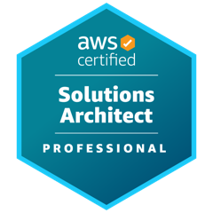
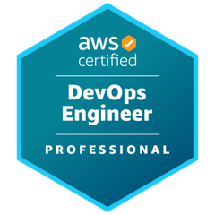
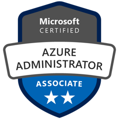

### About

Solutions Architect at CBTW, building cloud platforms on AWS and Azure: landing
zones, multi-account CI/CD, and data and AI pipelines. Currently an AWS Platform
Engineer for Partenamut.

Before consulting, I co-authored two research papers on the Semantic Web and
Knowledge Graphs at IDLab – imec, and built
[pyRDF2Vec](https://github.com/predict-idlab/pyRDF2Vec), a library widely cited
by the research community. Outside of work, I keep refining my
[Emacs configuration](https://github.com/rememberYou/.emacs.d).

Let's connect for a chat over a drink, unless you're one of those influencers
who take pictures of their meals ;-)

---

### Contact

- Website: [rememberyou.github.io](https://rememberyou.github.io), with my CV
  and master's thesis
- Email: [terencio.agozzino@gmail.com](mailto:terencio.agozzino@gmail.com)
- LinkedIn: [linkedin.com/in/terencioagozzino](https://www.linkedin.com/in/terencioagozzino/)
- IRC: `/q rememberYou` (`#archlinux` or `#emacs`) on `irc.libera.chat`
- PGP: [208FCDBB98190562](https://raw.githubusercontent.com/rememberYou/rememberYou/main/publickey.txt)
